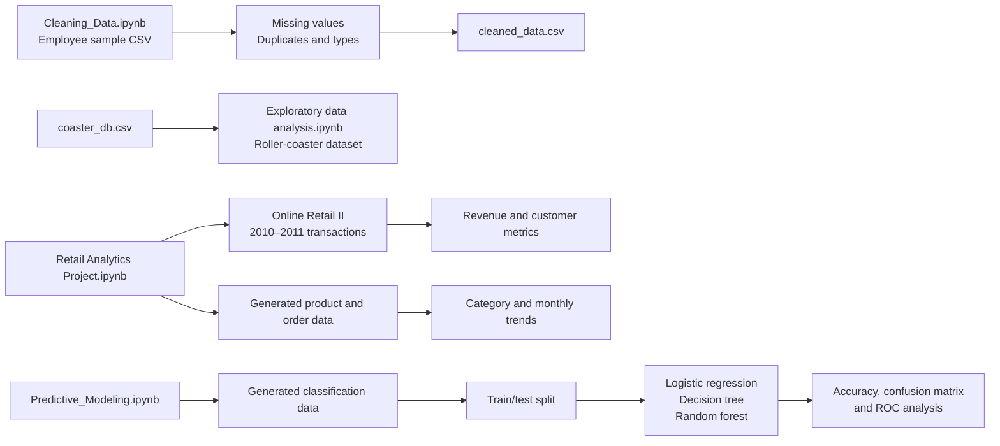
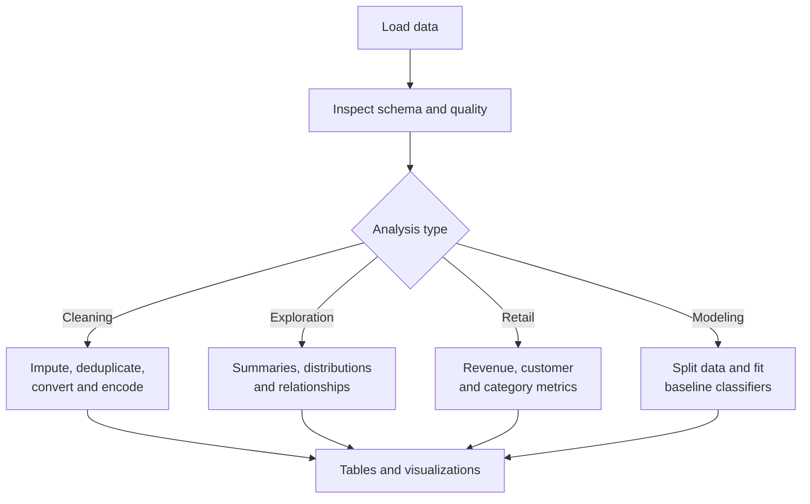

# Data Analytics & Machine Learning Portfolio

<div align="center">

### From raw records to useful insights

A Jupyter Notebook portfolio covering data cleaning, exploratory analysis, retail performance, and introductory classification.


</div>

---

## Contents

- [Project overview](#project-overview)
- [Portfolio map](#portfolio-map)
- [Notebook guide](#notebook-guide)
- [Datasets and outputs](#datasets-and-outputs)
- [Getting started](#getting-started)
- [Suggested run order](#suggested-run-order)
- [Reproducibility and notes](#reproducibility-and-notes)

## Project overview

This repository is a collection of hands-on data projects, not a single application or production machine-learning service. Each notebook demonstrates a different stage of an analytics workflow:

1. Inspect and prepare imperfect data.
2. Explore distributions, relationships, and trends.
3. Calculate and communicate business-oriented metrics.
4. Train and compare baseline classification models.

The notebooks are designed to be explored interactively. Run cells in order, inspect the intermediate DataFrames and charts, and adapt the analysis to ask new questions.

## Portfolio map



> The roller-coaster EDA uses `coaster_db.csv` directly; it is a separate analysis and does not consume the employee-cleaning output.

## Notebook guide

| Notebook | What it covers | Data and main outputs |
| --- | --- | --- |
| [`Cleaning_Data.ipynb`](Cleaning_Data.ipynb) | Identifies missing values, fills missing ages with the median and salaries with the mean, removes rows without a join date, removes duplicate name/age pairs, converts join dates, and one-hot encodes departments. | Reads `sample_data_cleaning_project.csv` and writes `cleaned_data.csv`. Also creates employee and salary visualizations. |
| [`Exploratory data analysis.ipynb`](Exploratory%20data%20analysis.ipynb) | Examines coaster attributes and distributions, compares speed with height and year, calculates correlations, and compares average speed by location. | Reads `coaster_db.csv` (1,087 rows and 56 columns in the notebook output). Uses Matplotlib and Seaborn for plots. |
| [`Retail Analytics Project.ipynb`](Retail%20Analytics%20Project.ipynb) | Computes transaction revenue and customer counts from Online Retail II, then explores daily sales and top products. It also creates a separate synthetic product/order dataset for category, customer, and monthly sales analyses. | Downloads the 2010–2011 sheet from the UCI Online Retail II Excel workbook at runtime. The saved notebook output reports 541,910 transactions, 4,372 unique customers, and total sales of 9,747,765.93. Synthetic track: 100 products and 1,000 orders. |
| [`Predictive_Modeling.ipynb`](Predictive_Modeling.ipynb) | Creates a reproducible binary classification dataset, makes a stratified 80/20 train/test split, compares three classifiers, and evaluates predictions with a confusion matrix and ROC curves. | Uses scikit-learn's `make_classification`; the saved output reports accuracy of 0.8200 for Logistic Regression, 0.8450 for Decision Tree, and 0.8900 for Random Forest. |

### Analysis lifecycle



## Datasets and outputs

| File | Role |
| --- | --- |
| `sample_data_cleaning_project.csv` | Small employee-style sample dataset with missing values and repeated records for the cleaning exercise. |
| `cleaned_data.csv` | Output written by `Cleaning_Data.ipynb`. It contains the transformed employee data and one-hot encoded department columns. Re-run the cleaning notebook to regenerate it. |
| `coaster_db.csv` | Roller-coaster dataset used by the exploratory analysis notebook. |
| Online Retail II workbook | External UCI dataset loaded by the retail notebook; it is not stored in this repository and requires an internet connection when that notebook fetches it. |

The predictive-modeling dataset and the retail notebook's product/order tables are generated in notebook code; they are not separate input files.

## Getting started

### Requirements

- Python 3.9 or newer
- Jupyter Notebook or JupyterLab
- `pandas`
- `numpy`
- `matplotlib`
- `seaborn`
- `scikit-learn`
- `openpyxl` (needed to read the retail Excel workbook)

Install the dependencies in a virtual environment:

```bash
python -m venv .venv
```

Activate it:

```bash
# Windows PowerShell
.\.venv\Scripts\Activate.ps1

# macOS / Linux
source .venv/bin/activate
```

Install packages and launch Jupyter:

```bash
python -m pip install pandas numpy matplotlib seaborn scikit-learn openpyxl jupyter
jupyter notebook
```

Open a notebook from the Jupyter file browser and choose **Kernel → Restart & Run All** to reproduce its analysis. The notebooks that read local CSVs expect the CSV files to remain in the project directory.

## Suggested run order

For a guided introduction, run:

1. `Cleaning_Data.ipynb` — start with missing values, duplicates, and data types.
2. `Exploratory data analysis.ipynb` — practice univariate and relationship analysis.
3. `Retail Analytics Project.ipynb` — apply aggregations and sales metrics to transaction data.
4. `Predictive_Modeling.ipynb` — compare baseline classification models.

The notebooks are otherwise independent; you can open any one directly.

## Reproducibility and notes

- Several notebooks include saved cell outputs. These outputs are examples from a previous run; **Restart & Run All** is the authoritative way to regenerate them.
- The retail analysis downloads an Excel file from UCI, so that notebook needs network access. Its transaction revenue is calculated as `Quantity × Price`; interpret the result in the context of the source data and the notebook's calculation.
- The retail notebook's generated product/order example is synthetic and separate from the Online Retail II transaction analysis.
- The classification exercise uses synthetic data and is intended to demonstrate a workflow, not to make claims about a real-world prediction task.
- Charts are generated in notebook cells rather than stored as image assets. Mermaid diagrams in this README summarize the project structure and workflow.
